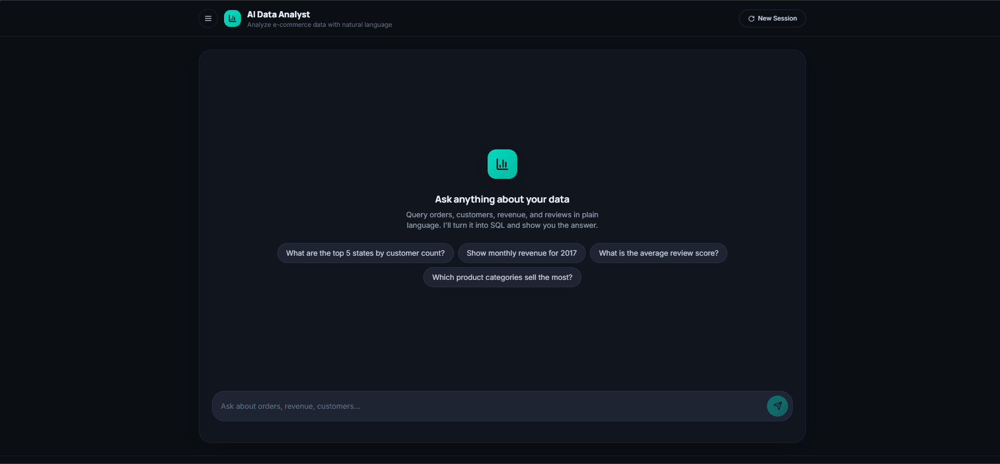
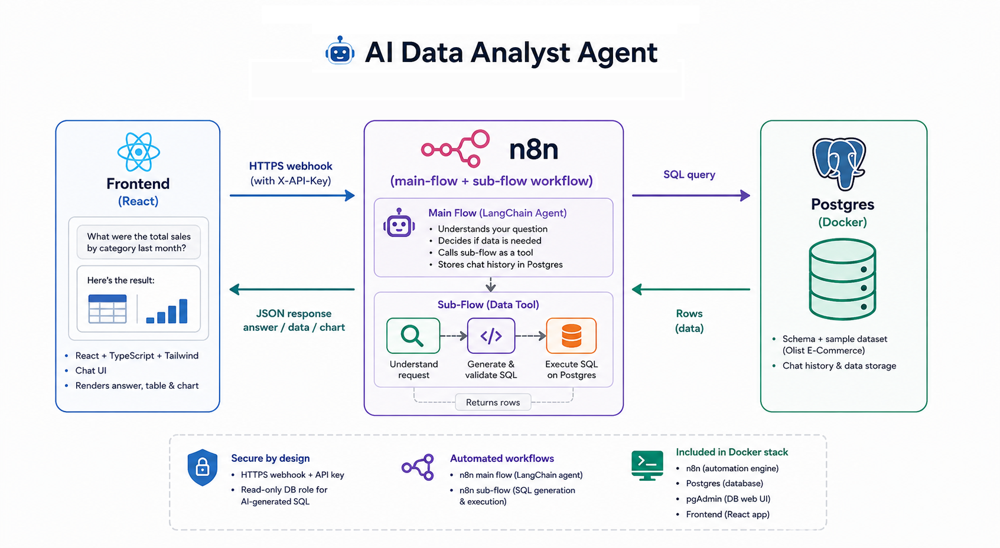

# AI Data Analyst Agent

An AI-powered agent that lets non-technical users query a PostgreSQL
e-commerce database in plain natural language, without writing SQL. It
translates a business question into SQL, executes it against a live
database, and returns a natural-language answer alongside a supporting
table and chart. The system is built as a fully containerized, self-hosted
stack combining a React frontend, a Python agent backend, and PostgreSQL.

## Demo

<p align="center">
  
</p>

A typical interaction:

1. The user asks a business question in natural language (e.g. "What are
   the top 5 states by customer count?").
2. The main conversational agent decides whether answering the question
   requires database access.
3. If it does, the agent calls a dedicated database-query workflow as a
   tool, passing along a natural-language description of what data is
   needed.
4. That workflow generates a SQL query, runs it through a validation step,
   and executes it against PostgreSQL.
5. The result is returned to the main agent, which produces a final
   natural-language answer. The frontend renders the answer together with
   a data table and, where applicable, a chart.

## Problem

Business stakeholders in e-commerce and similar data-driven companies
frequently need answers to analytical questions — payment method
distribution, delivery times by region, top-selling categories — but
getting those answers typically requires SQL knowledge. This turns the
data team into a bottleneck for even simple, recurring questions and slows
down decision-making.

## Solution

This project replaces ad-hoc SQL requests with a conversational agent that
sits in front of the database. Users interact with a chat interface;
behind it, an orchestrated set of workflows handles the reasoning about
what data is needed, generates and validates the SQL required to get it,
and turns the raw result back into a readable answer. The goal is to
demonstrate a working, end-to-end AI-agent architecture for
database-backed question answering — not a general-purpose BI tool.

## Key Features

- Natural-language interaction with a PostgreSQL business database
- Agent-based architecture with explicit tool calling: the conversational
  agent decides when database access is needed and invokes a dedicated
  workflow to get it
- Natural-language-to-SQL generation using an LLM
- A validation step that gates SQL execution
- Conversation memory persisted in PostgreSQL, so follow-up questions
  retain context
- Structured agent output (a consistent answer/data/chart contract)
  consumed by the frontend
- React + TypeScript chat UI with tables, CSV export, and charts
  (bar/line/pie)
- Fully reproducible local environment via Docker Compose, including
  automatic database schema and sample-data initialization on first start
- Clear separation between conversational orchestration and SQL
  generation/execution, implemented as two distinct functions inside the
  backend service

## Architecture

<p align="center">
  
</p>

> **Note:** this project originally orchestrated the two functions below as
> two separate n8n workflows. They have since been reimplemented as a single
> Python service in `backend/app.py` with the same two-stage design and the
> same request/response contract. The original n8n version is preserved
> under the [`n8n-version` tag](https://github.com/paget82/ai-data-analyst/tree/n8n-version).


### Frontend

React + TypeScript + Tailwind chat UI. It sends the user's message to the
backend's webhook endpoint (authenticated with a header-based API key) and
renders whatever comes back: a text answer, and optionally a data table
and/or chart.

### Main Agent (`run_agent` in `backend/app.py`)

Receives the incoming message and runs a tool-calling loop against an
OpenAI chat model that:

- Carries on the conversation with the user
- Decides, per message, whether answering requires querying the database
- If so, calls the `database_query` function as a tool, passing a
  natural-language description of the data need
- Reads and writes conversation history to PostgreSQL, so multi-turn
  context is preserved across messages
- Produces a structured output (validated/auto-fixed against a JSON schema)
  so the frontend receives a predictable response shape rather than
  free-form text

### Database Query Tool (`database_query` in `backend/app.py`)

Invoked by the main agent as a tool. It:

1. Receives a natural-language description of the requested data
2. Generates a SQL query using an LLM (Anthropic Claude)
3. Runs the generated query through a validation step (SELECT/WITH only,
   destructive statements blocked)
4. If validation passes, executes the query against PostgreSQL; if it
   fails, execution is skipped and a safe error result is returned instead
5. Formats the result and returns it to the calling agent

### PostgreSQL

Runs in its own container and initializes automatically on first start:
a schema is created and a small synthetic sample dataset — modeled on the
structure of the Olist Brazilian e-commerce dataset — is loaded via SQL
`COPY` from CSV files bundled in the repository. This makes the project
runnable end-to-end immediately after cloning, without any external data
dependency.

### pgAdmin

Included as a web-based UI for inspecting the PostgreSQL database (tables,
data, running ad-hoc queries) during development and debugging.

## Why are the two responsibilities separated?


The backend is split into two functions: one responsible for conversational
reasoning and orchestration (`run_agent`), and one responsible purely for
turning a data request into SQL and executing it (`database_query`). The
main agent never generates or runs SQL directly — it delegates that
responsibility entirely to `database_query` through a tool call.

This separation keeps the two concerns independent: the conversational
agent's prompt and behavior can be iterated on without touching SQL
generation logic, and the SQL generation/validation logic can be tested,
adjusted, or swapped out without affecting how the agent talks to the
user. It also means `database_query` could, in principle, be reused by a
different caller if the frontend or the calling agent changed.

## AI / LLM Pipeline

1. The user submits a question through the frontend.
2. The main agent (OpenAI chat model) reasons about the message and
   decides whether it needs data from the database.
3. If it does, the agent invokes the `database_query` tool, passing a
   natural-language description of what's needed as the tool input.
4. The SQL-generation step (Anthropic Claude) turns that description into
   a SQL query.
5. The generated query passes through a validation step before it is
   allowed to run.
6. The query is executed against PostgreSQL (or skipped, with an error
   result, if validation fails).
7. The result is returned to the main agent as the tool's output.
8. The main agent incorporates the result into a structured final
   response (answer text, plus table/chart data where relevant), which the
   frontend renders.

Two different LLM providers are used for two different responsibilities:
OpenAI for conversational reasoning and orchestration in the main agent,
and Anthropic Claude for SQL generation in `database_query`.


## Architecture Decisions

### Why a plain Python backend?

The backend is a single Flask service (`backend/app.py`) that hosts the
agent's tool-calling loop, memory persistence, and the SQL
generation/validation/execution steps. It was originally prototyped as two
n8n workflows (visual, inspectable, good for iterating on the agent and
tool-calling flow step-by-step); once the design was validated, it was
reimplemented as plain Python for a smaller, code-reviewable, dependency-free
runtime with no separate workflow-engine container to operate.

### Why PostgreSQL?

PostgreSQL is a widely used relational database well suited to a
SQL-generation demo — it's the direct target for LLM-generated queries and
also stores conversation memory for the main agent, so the whole stack
only needs a single database engine.

### Why separate functions instead of one prompt?

As described above, separating conversational orchestration from SQL
generation/execution keeps each concern independently testable and
modifiable, and makes explicit which component is responsible for
producing and running SQL.

### Why Docker Compose?

The full stack (frontend, backend, PostgreSQL, pgAdmin) is defined as a
single Docker Compose file, so it can be started with one command and
behaves the same way regardless of the host machine. Database schema and
sample-data initialization run automatically on first start, so a fresh
clone is runnable without manual data setup.

### Why React + TypeScript?

The frontend only needs to send a message and render a structured
response (text, table, chart), so a lightweight React + TypeScript SPA was
sufficient; TypeScript keeps the response contract between the backend
and the UI explicit.

### Why two LLM providers?

The main agent (OpenAI) and the SQL-generation step (Anthropic Claude) use
different providers because they are separate components with separate
responsibilities — this follows directly from the separation described
above, rather than being a deliberate multi-provider strategy.

## Evaluation

Automated evaluation is not currently implemented. There is no curated
question set, no automated check of SQL correctness or execution success,
and no measurement of answer quality, latency, or token usage. A future
version could evaluate the agent against a fixed set of representative
questions, checking whether the generated SQL executes successfully,
whether it returns the expected result, and tracking latency and token
cost per request.

## Tech Stack

### Frontend

- React
- TypeScript
- Tailwind CSS

### Backend / AI Orchestration

- Python (Flask, tool-calling loop, SQL validation)
- OpenAI (conversational agent)
- Anthropic Claude (SQL generation)

### Data

- PostgreSQL
- SQL

### Infrastructure

- Docker
- Docker Compose

### Database Tooling

- pgAdmin


## Getting Started

### Prerequisites

- **Docker and Docker Compose.**
  - Windows/macOS: install [Docker Desktop](https://docs.docker.com/get-docker/)
    and make sure it's actually **running** before using any `docker`
    command (it provides the background engine the CLI talks to — the
    terminal commands will fail with a connection error otherwise). Free
    alternative: [Rancher Desktop](https://rancherdesktop.io/).
  - Linux: no desktop app needed — install
    [Docker Engine](https://docs.docker.com/engine/install/) directly as a
    system service (e.g. `curl -fsSL https://get.docker.com | sh && sudo systemctl enable --now docker`).
- An [OpenAI](https://platform.openai.com/api-keys) API key
- An [Anthropic](https://console.anthropic.com/settings/keys) API key

### 1. Configure environment variables

```bash
cp .env.example .env
```

Edit `.env` — at minimum set `OPENAI_API_KEY`, `ANTHROPIC_API_KEY`, and
change `POSTGRES_PASSWORD`, `PGADMIN_DEFAULT_PASSWORD`, and `API_AUTH_TOKEN`
(e.g. `openssl rand -hex 24`) to your own values. Everything else can stay
at its default for a local run.

### 2. Start the database

```bash
docker compose up -d postgres pgadmin
```

On its **very first start** (empty volume), Postgres automatically runs
everything in `db/init/` in order:

- `01-schema.sql` — creates the tables.
- `02-load-data.sql` — loads the CSVs from `db/data/` via `COPY`.

The repo ships with a small **synthetic sample dataset** (few hundred rows,
same filenames/columns as the real Olist dataset) so the stack is fully
functional right after cloning.

Browse the data at **http://localhost:5050** (pgAdmin — log in with
`PGADMIN_DEFAULT_EMAIL` / `PGADMIN_DEFAULT_PASSWORD` from `.env`, then add a
new server with host `postgres`, port `5432`, and the `POSTGRES_USER` /
`POSTGRES_PASSWORD` from `.env`).

### 3. Start the backend

```bash
docker compose up -d --build backend
```

This builds and starts the Python service (`backend/app.py`) that replaces
n8n: it reads `OPENAI_API_KEY`, `ANTHROPIC_API_KEY`, `API_AUTH_TOKEN`, and
the `POSTGRES_*` values straight from `.env`, so there's no manual
credential setup or workflow import step — it's ready as soon as the
container is healthy.

- Health check: `curl http://localhost:5679/healthz` → `{"status": "ok"}`
- Chat endpoint: `POST http://localhost:5679/webhook/data-analyst-agent`
  with header `X-API-Key: <your API_AUTH_TOKEN>` and body
  `{"message": "...", "session_id": "..."}` — should match `VITE_API_URL`
  in your `.env`.

### 4. Start the frontend

```bash
docker compose up -d --build frontend
```

Open **http://localhost:3000** and start asking questions
("What were total sales in 2017?", "Top 5 product categories by revenue",
"Average delivery time by state").

### Everything at once

```bash
docker compose up -d --build
```

- Frontend: http://localhost:3000
- Backend: http://localhost:5679
- pgAdmin: http://localhost:5050


## Project structure

```
docker-compose.yml         # postgres + pgadmin + backend + frontend
.env.example                 # docker-compose environment template
db/
  init/
    01-schema.sql              # table definitions (auto-run on first start)
    02-load-data.sql            # COPY commands loading db/data/*.csv
  data/                       # CSVs — ships with a synthetic sample, swap for real Olist data
backend/
  app.py                     # chat agent, memory, webhook, NL → SQL generation + execution
  requirements.txt
  Dockerfile
frontend/                   # React/TypeScript/Tailwind chat UI (see frontend/README.md)
```

## Troubleshooting

- **Frontend shows a timeout / can't reach the backend** — confirm the
  `backend` container is healthy (`docker compose ps`, or
  `curl http://localhost:5679/healthz`), and that `VITE_API_URL` matches
  its published address exactly.
- **401 from the webhook** — the `X-API-Key` header sent by the frontend
  (`VITE_API_AUTH_TOKEN`) must match the backend's `API_AUTH_TOKEN`.
- **`database_query` tool returns errors** — check the backend logs
  (`docker compose logs -f backend`); the SQL Anthropic generated and the
  validation/DB error are included in the tool result.
- **Backend can't connect to Postgres** — use host `postgres`, not
  `localhost`; the backend and Postgres talk to each other over the Docker
  Compose network, not your machine's. This is already set via
  `POSTGRES_HOST=postgres` in `docker-compose.yml`.
- **Data didn't load / table is empty** — the init scripts in `db/init/`
  only run on a *fresh* volume. If you'd already started Postgres once,
  reset with `docker compose down -v postgres` before trying again.
- **Frontend env changes don't show up** — `VITE_*` vars are baked in at
  Docker build time; re-run `docker compose up -d --build frontend` after
  editing `.env`.

## Limitations

- The bundled dataset is small and synthetic (modeled on, but not equal
  to, the real Olist dataset); it is intended to make the project runnable
  out of the box, not to represent production data volume or variety.
- The stack is designed for local, single-user demonstration via Docker
  Compose; it has no deployment configuration for a hosted/cloud
  environment.
- There is no automated evaluation of SQL correctness or answer quality —
  correctness has been checked manually during development.
- There is no authentication/authorization layer beyond the shared
  webhook API key; there is no per-user access control.
- There is no structured logging, tracing, or monitoring of agent
  behavior, latency, or token usage.
- There are no automated tests or CI pipeline.

## Future Improvements

- Automated evaluation against a curated question set (SQL execution
  success, answer correctness, latency, token usage)
- A restricted, read-only PostgreSQL role dedicated to the query-execution
  step, enforced independently of the LLM-based validation
- Authentication/authorization and per-user access control
- Row-level security for multi-tenant scenarios
- Structured logging and tracing across the agent/tool-calling pipeline
- Latency and token-cost monitoring
- Automated tests and a CI pipeline
- A documented path to a cloud deployment
- Caching for repeated queries/results
- More robust failure handling for malformed or partially-valid SQL

## Engineering Perspective

This project is a working example of an agent architecture that separates
conversational reasoning from tool execution: a main agent decides *when*
external data access is needed and delegates *how* to get it to a
dedicated function, rather than mixing conversation and SQL generation
into a single step. It demonstrates natural-language-to-SQL generation
with a validation gate before execution, conversational memory backed by a
real database, a defined contract between the backend and the
frontend, and a fully reproducible, containerized local environment.
Building and debugging it also surfaced concrete integration issues —
Docker container networking, and distinguishing a genuine failure from a
silent fallback response — that are representative of the kind of
debugging involved in shipping an LLM-agent system end to end, beyond
simply wiring an LLM to a database.

## License

[MIT](./LICENSE)
