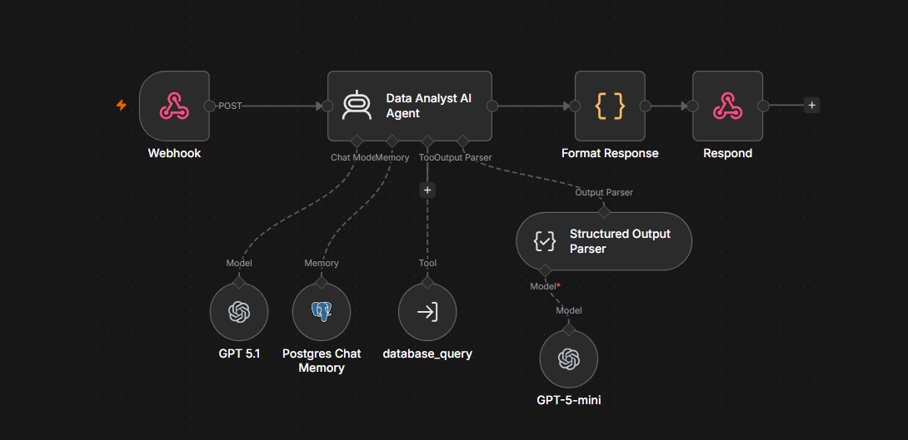
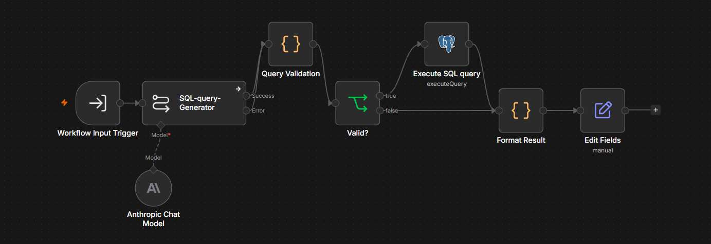
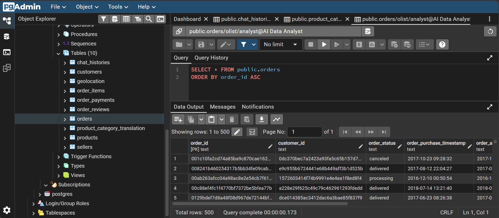

# AI Data Analyst Agent


## Problem

An e-commerce company had a large, well-structured operational database, but
only people who could write SQL could actually get answers out of it.
Business stakeholders had to go through a data team for even simple
questions ("Show me the payment method distribution?", "What is the average delivery time by state?"), which slowed decision-making and put
unnecessary load on technical staff.

## Goal

Build an AI-powered data analyst agent that lets anyone on the team ask
questions about the company's data in plain, everyday language — and get
back a clear written answer, plus a supporting table and chart — without
writing a single line of SQL themselves.


## Architecture

<p align="center">
  
</p>

- **Frontend** — React + TypeScript + Tailwind chat UI. Sends your message to
  an n8n webhook and renders the response (text, table, and/or chart).

  <p align="center">
    
  </p>

- **n8n (`main-flow`)** — a LangChain agent (GPT) that talks to you, decides
  when it needs data, and calls the `sub-flow` as a tool. Chat history is
  stored in Postgres.

  <p align="center">
    
  </p>

- **n8n (`sub-flow`)** — turns a natural-language data request into a SQL
  query (Anthropic/Claude), validates it, and runs it against Postgres.

  <p align="center">
    
  </p>

- **Postgres** — runs in its own container and auto-loads on first start with
  a schema + sample dataset modeled on the Olist Brazilian E-Commerce. **pgAdmin** is included as a web UI for it.

  <p align="center">
    
  </p>


## Prerequisites

- **Docker and Docker Compose.**
  - Windows/macOS: install [Docker Desktop](https://docs.docker.com/get-docker/)
    and make sure it's actually **running** before using any `docker`
    command (it provides the background engine the CLI talks to — the
    terminal commands will fail with a connection error otherwise). Free
    alternative: [Rancher Desktop](https://rancherdesktop.io/).
  - Linux: no desktop app needed — install
    [Docker Engine](https://docs.docker.com/engine/install/) directly as a
    system service (e.g. `curl -fsSL https://get.docker.com | sh && sudo systemctl enable --now docker`).
- An [OpenAI](https://platform.openai.com/api-keys) API key
- An [Anthropic](https://console.anthropic.com/settings/keys) API key


## 1. Configure environment variables

```bash
cp .env.example .env
```

Edit `.env` — at minimum change `POSTGRES_PASSWORD`, `PGADMIN_DEFAULT_PASSWORD`,
and `VITE_N8N_AUTH_TOKEN` (e.g. `openssl rand -hex 24`) to your own values.
Everything else can stay at its default for a local run.

## 2. Start the database

```bash
docker compose up -d postgres pgadmin
```

On its **very first start** (empty volume), Postgres automatically runs
everything in `db/init/` in order:

- `01-schema.sql` — creates the tables.
- `02-load-data.sql` — loads the CSVs from `db/data/` via `COPY`.

The repo ships with a small **synthetic sample dataset** (few hundred rows,
same filenames/columns as the real Olist dataset) so the stack is fully
functional right after cloning.


Browse the data at **http://localhost:5050** (pgAdmin — log in with
`PGADMIN_DEFAULT_EMAIL` / `PGADMIN_DEFAULT_PASSWORD` from `.env`, then add a
new server with host `postgres`, port `5432`, and the `POSTGRES_USER` /
`POSTGRES_PASSWORD` from `.env`).


## 3. Start n8n and import the workflows

```bash
docker compose up -d n8n
```

Open **http://localhost:5679**, create your owner account, then:

1. **Create credentials** (Settings → Credentials → Add credential):
   - **Header Auth account** — Name: `X-API-Key`, Value: the same string you
     put in `VITE_N8N_AUTH_TOKEN` in `.env`.
   - **OpenAI account** — your OpenAI API key.
   - **Anthropic account** — your Anthropic API key.
   - **Postgres account** — Host: `postgres` (the Docker Compose service
     name — n8n reaches it over the internal Docker network, not
     `localhost`), Port: `5432`, Database/User/Password: your `POSTGRES_DB` /
     `POSTGRES_USER` / `POSTGRES_PASSWORD` from `.env`, SSL: `disable`.
     
2. **Import both workflows**: Workflows → Add workflow → **⋯ menu → Import
   from File**, and import `n8n/workflows/sub-flow.json` first, then
   `n8n/workflows/main-flow.json`.
3. In **`AI Data Analyst Agent - sub flow`**, open every node that shows a
   credential warning and pick the credential you created in step 1 (Postgres,
   Anthropic).
4. In **`AI Data Analyst Agent - main flow`**:
   - Fix credentials on the `Webhook`, `GPT 5.1` / `GPT-5-mini`, and
     `Postgres Chat Memory` nodes the same way.
   - Open the **`database_query`** node and re-select the sub-flow under
     **Workflow** — the imported copy gets a new internal ID, so this link
     needs to be reconnected manually.
   - **Check `Workflow Inputs` → `query_description` right after
     reconnecting.** Re-selecting the sub-flow sometimes resets this field
     to a plain empty/Fixed value instead of the expression that lets the
     agent fill it in. It must be set to **Expression** with exactly:
     ```
     {{ $fromAI('query_description', 'Natural language description of what data the user wants to query from the database', 'string') }}
     ```
     If it's missing, the sub-flow receives an empty query, its SQL
     generator produces something invalid, and the safety-fallback query
     `SELECT 1 AS result` runs instead — which looks like a working
     response (a real table renders) but is actually meaningless data. If
     every answer looks suspiciously flat (e.g. "1 order" no matter what
     you ask), check this first.
  
5. **Activate** both workflows (toggle in the top-right of each workflow).
6. Open the `Webhook` node in the main flow and copy its **Production URL**.
   It should look like `http://localhost:5679/webhook/data-analyst-agent`,
   matching `VITE_N8N_WEBHOOK_URL` in your `.env`. Update `.env` if the path
   differs.
   - If it instead shows port **5678** (n8n's internal port) instead of
     **5679** (the host port from `docker-compose.yml`'s `"5679:5678"`
     mapping), your `.env` is missing `N8N_WEBHOOK_BASE_URL` — see
     `.env.example`, then `docker compose up -d n8n` to apply it.

## 4. Start the frontend

```bash
docker compose up -d --build frontend
```

Open **http://localhost:3000** and start asking questions
("What were total sales in 2017?", "Top 5 product categories by revenue",
"Average delivery time by state").


## Everything at once

Once the workflows are imported and activated:

```bash
docker compose up -d --build
```

- Frontend: http://localhost:3000
- n8n: http://localhost:5679
- pgAdmin: http://localhost:5050


## Project structure

```
docker-compose.yml         # postgres + pgadmin + n8n + frontend
.env.example                 # docker-compose environment template
db/
  init/
    01-schema.sql              # table definitions (auto-run on first start)
    02-load-data.sql            # COPY commands loading db/data/*.csv
  data/                       # CSVs — ships with a synthetic sample, swap for real Olist data
  readonly_role.sql           # optional read-only DB role for safer SQL execution
n8n/
  workflows/
    main-flow.json            # chat agent, memory, webhook
    sub-flow.json               # NL → SQL generation + execution
frontend/                   # React/TypeScript/Tailwind chat UI (see frontend/README.md)
```

## Troubleshooting

- **Frontend shows a timeout / can't reach n8n** — confirm the main-flow
  workflow is *activated* (not just saved), and that `VITE_N8N_WEBHOOK_URL`
  matches the Production URL shown on the Webhook node exactly.
- **401 from the webhook** — the `X-API-Key` header sent by the frontend
  (`VITE_N8N_AUTH_TOKEN`) must match the value of the Header Auth credential
  in n8n.
- **`database_query` tool fails after import** — re-open the node and
  re-select the sub-flow workflow; imported workflow IDs don't match the
  original export.

- **Webhook's Production URL shows port 5678 instead of 5679** — n8n
  listens on 5678 inside the container and doesn't know about the
  `"5679:5678"` host port mapping unless told via `WEBHOOK_URL`. Make sure
  `N8N_WEBHOOK_BASE_URL=http://localhost:5679/` is set in `.env`, then
  `docker compose up -d n8n` to restart it with the variable applied.
- **n8n Postgres credential fails to connect** — use host `postgres`, not
  `localhost`; n8n and Postgres talk to each other over the Docker Compose
  network, not your machine's.
- **Data didn't load / table is empty** — the init scripts in `db/init/`
  only run on a *fresh* volume. If you'd already started Postgres once,
  reset with `docker compose down -v postgres` before trying again.
- **Frontend env changes don't show up** — `VITE_*` vars are baked in at
  Docker build time; re-run `docker compose up -d --build frontend` after
  editing `.env`.


## License

[MIT](./LICENSE)
